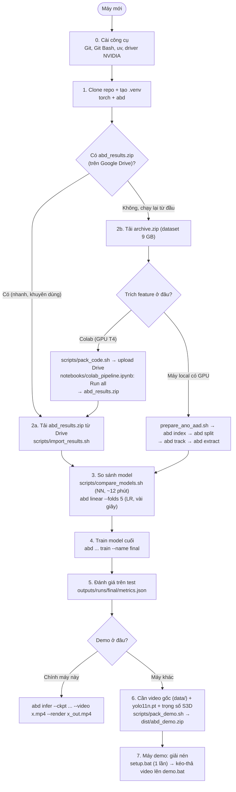

# Hướng dẫn setup & flow chạy trên máy mới

Kết quả hiện tại: [`results/README.md`](../results/README.md). Trạng thái / việc tiếp theo: [`STATUS.md`](STATUS.md).

## Flow tổng thể



| Bước | Chạy ở đâu | Thời gian (GTX 1070) | Output |
|---|---|---|---|
| 0–1. Cài đặt | máy mới | 5–10 phút (tải torch ~2.5 GB) | `.venv/` |
| 2a. Import kết quả | máy mới | < 1 phút | `outputs/` |
| 2b. Track + extract | Colab T4 / GPU local | vài giờ (395 video, 2 luồng) | `abd_results.zip` / `outputs/features/` |
| 3. So sánh | máy mới | ~12 phút | `outputs/runs/cmp_*`, `cvlr_*` |
| 4. Train cuối | máy mới | ~30 giây | `outputs/runs/final/best.pt` |
| 6. Đóng gói demo | máy mới | vài phút (render trước các video mẫu) | `dist/abd_demo.zip` |
| 7. Setup máy demo | máy demo | 5–10 phút, cần internet | `.venv/` trong bundle |

---

## 0. Công cụ cần có

**Windows** (PowerShell):
```powershell
winget install --id Git.Git -e                    # kèm Git Bash (scripts/*.sh chạy trong Git Bash)
powershell -ExecutionPolicy ByPass -c "irm https://astral.sh/uv/install.ps1 | iex"
nvidia-smi                                         # phải thấy GPU; driver cần hỗ trợ CUDA 12.4 (>= 551)
```

**macOS**:
```bash
brew install uv git
```

**Linux + NVIDIA**:
```bash
curl -LsSf https://astral.sh/uv/install.sh | sh
nvidia-smi
```

## 1. Clone repo + môi trường Python

```bash
git clone https://github.com/zenithbit/abnormal-behavior-detector.git
cd abnormal-behavior-detector
uv venv --python 3.11 .venv
```

**Windows + NVIDIA** (PowerShell hoặc Git Bash, trong thư mục repo):
```powershell
uv pip install --python .venv\Scripts\python.exe torch==2.5.1 torchvision==0.20.1 --index-url https://download.pytorch.org/whl/cu124
uv pip install --python .venv\Scripts\python.exe -e ".[dev]"
.venv\Scripts\python.exe -c "import torch; print(torch.__version__, torch.cuda.is_available())"
```
Dòng cuối phải in `2.5.1+cu124 True`.

**macOS** (MPS) / **Linux** (torch trên PyPI đã kèm CUDA):
```bash
uv pip install --python .venv/bin/python -e ".[dev]"
```

Kiểm tra:
```bash
.venv/Scripts/python.exe -m pytest -q     # Windows (Git Bash)
.venv/bin/pytest -q                       # macOS / Linux
```

> Các lệnh `abd ...` dưới đây: Windows dùng `.venv/Scripts/abd.exe`, macOS/Linux dùng `.venv/bin/abd`
> (hoặc kích hoạt venv trước: `source .venv/Scripts/activate` / `source .venv/bin/activate`).
> `scripts/*.sh` trên Windows chạy trong **Git Bash** và tự tìm `.venv`.

## 2a. Dùng kết quả có sẵn (khuyên dùng)

Tải `abd_results.zip` (282 MB) từ Google Drive (`MyDrive/abd/abd_results.zip`) vào thư mục repo:
```bash
scripts/import_results.sh abd_results.zip
```
Phải thấy `features: 395 videos`. `outputs/` cũ (nếu có) được đổi tên thành `outputs.bak.<thời gian>`.

## 2b. Chạy lại từ đầu (chỉ khi cần trích feature lại)

Cần `archive.zip` (dataset Ano-AAD từ Kaggle, ~9 GB).

**Trên Colab** (khi máy không có GPU mạnh):
1. `scripts/pack_code.sh` → `dist/abd_code.zip` (chỉ code đã commit).
2. Upload `archive.zip` và `abd_code.zip` vào `MyDrive/abd/`.
3. Mở `notebooks/colab_pipeline.ipynb` trên Colab, chọn GPU T4, **Run all** (bị ngắt thì Run all lại).
4. Tải `MyDrive/abd/abd_results.zip` về → bước 2a.

**Trên máy local có GPU**:
```bash
scripts/prepare_ano_aad.sh archive.zip data/Ano-AAD     # giải nén → data/Ano-AAD/{normal,abnormal/<Lớp>}
abd index                                               # → outputs/manifest.csv
abd split                                               # → outputs/splits.json (theo video, stratified)
abd track --render 5                                    # YOLO + ByteTrack → outputs/tracks/ (+5 video kiểm tra)
abd --set features.batch_size=8 extract                 # S3D (batch 8 vừa GPU 8 GB) frame + person → outputs/features/s3d/
```

## 3. So sánh model

```bash
scripts/compare_models.sh                               # NN: 3 luồng × 4 head, 5-fold CV, in bảng theo e2e macro-F1
for m in frame person both; do
  abd --set model.input=$m linear --name cvlr_$m --folds 5    # LR baseline, 5-fold CV
  abd --set model.input=$m linear --name lr_$m                # LR trên split cố định (val + test)
done
```
Kết quả lần chạy 2026-10-22: [`results/README.md`](../results/README.md). Tốt nhất: LR both (CV e2e F1 0.464), NN tốt nhất `both_notf` (0.355).

## 4–5. Train model cuối + đánh giá

```bash
abd --set model.input=both --set model.n_layers=0 --set model.d_model=128 --set model.dropout=0.5 train --name final
abd evaluate --ckpt outputs/runs/final/best.pt --split test
```
Metrics val + test: `outputs/runs/final/metrics.json`.

## 6. Demo

**Ngay trên máy này** (có GPU):
```bash
abd infer --ckpt outputs/runs/final/best.pt --video x.mp4 --render x_out.mp4
```

**Đóng gói cho máy khác** — `pack_demo.sh` cần thêm 3 thứ không có trong git:
```bash
# (1) video gốc: chọn 4–5 video thuộc tập TEST (xem outputs/splits.json)
scripts/prepare_ano_aad.sh archive.zip data/Ano-AAD
# (2) trọng số YOLO ở thư mục repo
.venv/Scripts/python.exe -c "from ultralytics import YOLO; YOLO('yolo11n.pt')"
# (3) trọng số S3D trong cache torch (~/.cache/torch/hub/checkpoints/s3d-*.pth)
.venv/Scripts/python.exe -c "from torchvision.models import video as v; v.s3d(weights=v.S3D_Weights.KINETICS400_V1)"

scripts/pack_demo.sh outputs/runs/final \
  data/Ano-AAD/abnormal/Fighting/07.mp4 data/Ano-AAD/normal/12.mp4      # ví dụ, cả hai thuộc tập test
```
→ `dist/abd_demo.zip` gồm code, `models/best.pt`, trọng số S3D + YOLO, video mẫu và bản đã render sẵn.

## 7. Máy demo (Windows + NVIDIA)

1. Copy `abd_demo.zip` sang, giải nén.
2. Double-click **`setup.bat`** (một lần, cần internet). Cuối phải thấy `CUDA: True`;
   thấy `CPU ONLY` → cập nhật driver NVIDIA (>= 551) rồi chạy lại.
3. Kéo-thả video lên **`demo.bat`** → `results\<tên>_result.mp4` (tự mở) + `.json`. Không cần internet.
4. Dự phòng: trình chiếu thẳng `samples\rendered\`.

Chi tiết: [`demo/README_DEMO.md`](../demo/README_DEMO.md).

## Tài khoản / key cần có

**Không cần API key hay token nào.** Repo public, clone không cần đăng nhập GitHub.
Mọi trọng số đều tự tải miễn phí lần đầu chạy (cần internet):

- S3D (Kinetics-400) — torchvision, lưu vào `~/.cache/torch/hub/checkpoints/`
- YOLO11n — ultralytics, lưu `yolo11n.pt` vào thư mục đang chạy

Chỉ cần quyền tải 2 file dữ liệu dưới đây (người giữ dự án gửi link Google Drive, chia sẻ dạng
"Bất kỳ ai có đường liên kết"). Dataset gốc cũng tải được từ Kaggle (cần tài khoản Kaggle miễn phí).

## Không có trong git

| File | Lấy ở đâu |
|---|---|
| `abd_results.zip` | Google Drive `MyDrive/abd/` |
| `archive.zip` (dataset) | Kaggle Ano-AAD / Google Drive `MyDrive/abd/` |
| `data/`, `outputs/`, `dist/`, `.venv/` | sinh ra bởi các bước trên |
